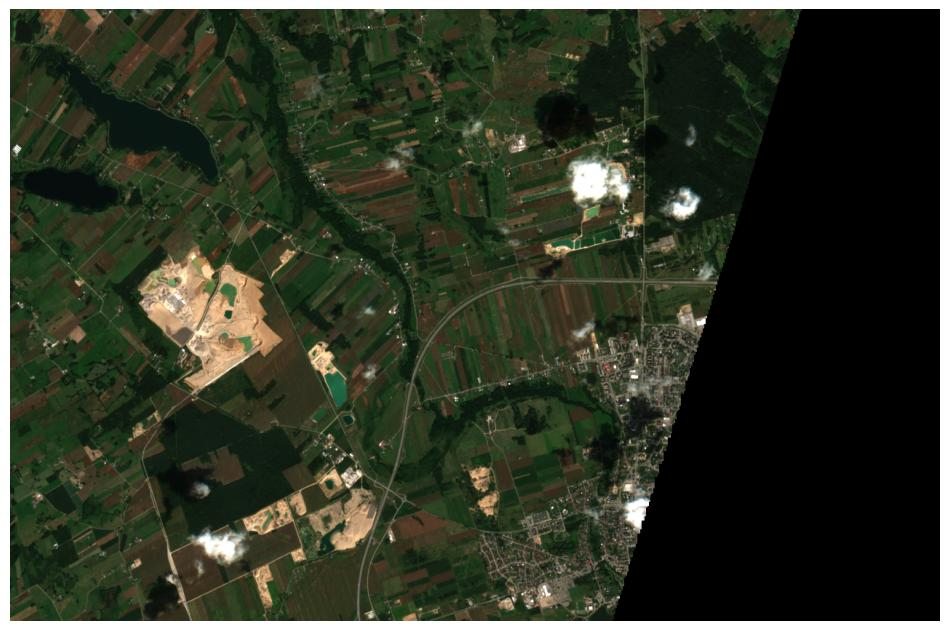
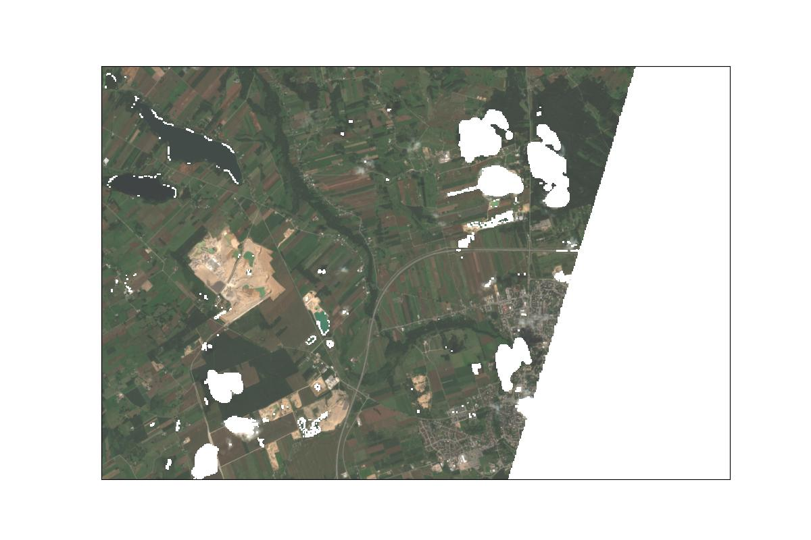

# Analiza porównawcza wskaźników roślinności z wykorzystaniem danych Sentinel-2

_Zastrzeżenie: Projekt edukacyjny mający na celu praktyczne zastosowanie wiedzy zdobytej w zakresie teledetekcji satelitarnej oraz podstaw przetwarzania i analizy danych przestrzennych._

Wskaźniki roślinności (ang. vegetation indices) to wskaźniki teledetekcyjne obliczane na podstawie odbicia promieniowania w wybranych pasmach spektralnych, służące do oceny stanu i kondycji roślinności.

W tym projekcie porównuję różne wskaźniki roślinności obliczone na podstawie tego samego zobrazowania satelitarnego Sentinel-2. Analizuję, w jaki sposób poszczególne wskaźniki charakteryzują roślinność oraz jak różnią się uzyskane rozkłady wartości.

<strong>Informacje o projekcie</strong>

##### Wykorzystane narzędzia

- [Python](https://www.python.org/)
- [JupyterLab](https://jupyter.org/)

 

<em>Tabela 1. Charakterystyka pasm spektralnych satelitów Sentinel-2</em>
<table border="1">
  <thead style="text-align: center;">
    <tr>
      <th></th>
      <th colspan="2">Sentinel-2A</th>
      <th colspan="2">Sentinel-2B</th>
    </tr>
    <tr>
      <th>Band Number</th>
      <th>Central wavelength (nm)</th>
      <th>Bandwidth (nm)</th>
      <th>Central wavelength (nm)</th>
      <th>Bandwidth (nm)</th>
      <th>Spatial resolution (m)</th>
    </tr>
  </thead>
  <tbody style="text-align: center;">
    <tr>
      <td>1</td>
      <td>442.7</td>
      <td>20</td>
      <td>442.3</td>
      <td>20</td>
      <td>60</td>
    </tr>
    <tr>
      <td>2</td>
      <td>492.7</td>
      <td>65</td>
      <td>492.3</td>
      <td>65</td>
      <td>10</td>
    </tr>
    <tr>
      <td>3</td>
      <td>559.8</td>
      <td>35</td>
      <td>558.9</td>
      <td>35</td>
      <td>10</td>
    </tr>
    <tr>
      <td>4</td>
      <td>664.6</td>
      <td>30</td>
      <td>664.9</td>
      <td>31</td>
      <td>10</td>
    </tr>
    <tr>
      <td>5</td>
      <td>704.1</td>
      <td>14</td>
      <td>703.8</td>
      <td>15</td>
      <td>20</td>
    </tr>
    <tr>
      <td>6</td>
      <td>740.5</td>
      <td>14</td>
      <td>739.1</td>
      <td>13</td>
      <td>20</td>
    </tr>
    <tr>
      <td>7</td>
      <td>782.8</td>
      <td>19</td>
      <td>779.7</td>
      <td>19</td>
      <td>20</td>
    </tr>
    <tr>
      <td>8</td>
      <td>832.8</td>
      <td>105</td>
      <td>832.9</td>
      <td>104</td>
      <td>10</td>
    </tr>
    <tr>
      <td>8a</td>
      <td>864.7</td>
      <td>21</td>
      <td>864.0</td>
      <td>21</td>
      <td>20</td>
    </tr>
    <tr>
      <td>9</td>
      <td>945.1</td>
      <td>19</td>
      <td>943.2</td>
      <td>20</td>
      <td>60</td>
    </tr>
    <tr>
      <td>10</td>
      <td>1373.5</td>
      <td>29</td>
      <td>1376.9</td>
      <td>29</td>
      <td>60</td>
    </tr>
    <tr>
      <td>11</td>
      <td>1613.7</td>
      <td>90</td>
      <td>1610.4</td>
      <td>94</td>
      <td>20</td>
    </tr>
    <tr>
      <td>12</td>
      <td>2202.4</td>
      <td>174</td>
      <td>2185.7</td>
      <td>184</td>
      <td>20</td>
    </tr>
  </tbody>
</table>
<em style="font-size: 0.85em;">Źródło: https://www.earthdata.nasa.gov/data/instruments/sentinel-2-msi</em>

 

   
  <em>Rysunek 1. Zobrazowanie analizowanego obszaru w naturalnych barwach </em>

 

Do obliczenia wartości omawianych wskaźników roślinności dla analizowanego obszaru wykorzystałem dane z poszczególnych pasm spektralnych Sentinel-2. Przed wykonaniem obliczeń zastosowałem maskę wykluczającą wybrane klasy pikseli, w tym piksele reprezentujące brak danych, piksele nasycone lub uszkodzone, cienie oraz zachmurzenie. Obecność takich pikseli w danych wejściowych mogłaby prowadzić do zniekształcenia wyników analiz. Do identyfikacji pikseli podlegających maskowaniu wykorzystałem warstwę [Scene Classification Layer (SCL)](https://custom-scripts.sentinel-hub.com/custom-scripts/sentinel-2/scene-classification/). Z obliczeń wykluczyłem następujące klasy pikseli:

- 0 - No data – brak danych
- 1 - Saturated/defective – piksele nasycone lub uszkodzone
- 2	- Topographic casted shadows – cienie topograficzne
- 3	- Cloud shadows – cienie chmur
- 7	- Unclassified - piksele niesklasyfikowane
- 8	- Cloud, medium probability - średnie prawdopodobieństwo wystąpienia chmur
- 9	- Cloud, high probability - wysokie prawdopodobieństwo wystąpienia chmur
- 10 - Thin cirrus - cienkie chmury typu cirrus

Rysunek 2 przedstawia obraz analizowanego obszaru w naturalnych barwach po zastosowaniu maskowania.

 

   
  <em>Rysunek 2. Zobrazowanie analizowanego obszaru w barwach naturalnych na podstawie danych Sentinel-2, z zastosowaniem warstwy SCL do maskowania wybranych klas pikseli. </em>

 

 

<em>Tabela 2. Statystyki opisowe indeksów wegetacyjnych obliczonych na podstawie zobrazowania Sentinel-2</em>
<table border="1" class="dataframe" style="width: 100%;">
  <thead>
    <tr style="text-align: center;">
      <th></th>
      <th>Mean</th>
      <th>Std</th>
      <th>Min</th>
      <th>P5</th>
      <th>P25</th>
      <th>P50 (Median)</th>
      <th>P75</th>
      <th>P95</th>
      <th>Max</th>
    </tr>
  </thead>
  <tbody style="text-align: center;">
    <tr>
      <th>NDVI</th>
      <td>0.39</td>
      <td>0.16</td>
      <td>-0.28</td>
      <td>0.06</td>
      <td>0.29</td>
      <td>0.43</td>
      <td>0.51</td>
      <td>0.61</td>
      <td>0.71</td>
    </tr>
    <tr>
      <th>EVI</th>
      <td>0.42</td>
      <td>0.20</td>
      <td>-0.30</td>
      <td>0.06</td>
      <td>0.28</td>
      <td>0.44</td>
      <td>0.57</td>
      <td>0.73</td>
      <td>1.04</td>
    </tr>
    <tr>
      <th>SAVI</th>
      <td>0.31</td>
      <td>0.14</td>
      <td>-0.20</td>
      <td>0.05</td>
      <td>0.21</td>
      <td>0.32</td>
      <td>0.41</td>
      <td>0.51</td>
      <td>0.68</td>
    </tr>
    <tr>
      <th>GNDVI</th>
      <td>0.37</td>
      <td>0.13</td>
      <td>-0.36</td>
      <td>0.12</td>
      <td>0.30</td>
      <td>0.39</td>
      <td>0.46</td>
      <td>0.55</td>
      <td>0.84</td>
    </tr>
    <tr>
      <th>NDRE</th>
      <td>0.28</td>
      <td>0.12</td>
      <td>-0.30</td>
      <td>0.04</td>
      <td>0.21</td>
      <td>0.29</td>
      <td>0.36</td>
      <td>0.46</td>
      <td>0.59</td>
    </tr>
  </tbody>
</table>